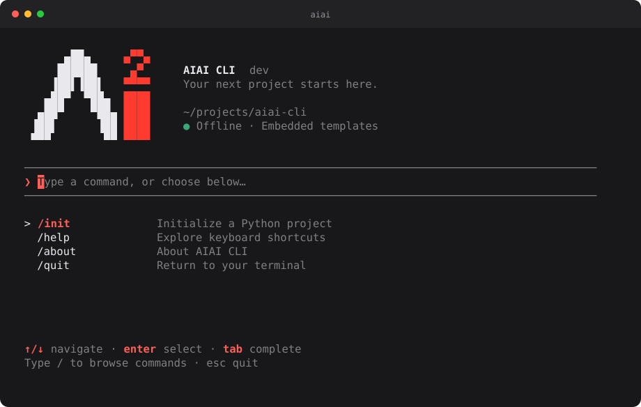

<p align="center">
  
</p>

# AIAI CLI

A local-first developer workspace with Git browsing, project registration,
project-aware focus tracking, SSH tools, and deterministic scaffolding. It uses
Cobra and Bubble Tea. Templates are compiled into the binary; generation works offline
and does not run subprocesses or install dependencies. Optional GitHub sign-in
provides an AIAI session for online features without changing the offline workflow.



## Installation

### Quick install (recommended)

Install the pre-built standalone binary without requiring Go or any runtime:

```bash
curl -fsSL https://raw.githubusercontent.com/AIAI-Laboratory/aiai-cli/main/install.sh | bash
```

The script automatically detects your OS and architecture (macOS/Linux on ARM64/AMD64) and places `aiai` into `~/.local/bin`.

### Build from source (developers)

Go 1.27.2+ is required to build from source:

```bash
go build -trimpath -o bin/aiai ./cmd/aiai
./bin/aiai
```

The home screen groups commands into Project, SSH, Account, and AIAI categories;
**/help** and **/quit** remain directly accessible. Enter opens a category and
Esc returns home. Typing searches every command immediately, Tab completes, and
Enter selects. Arrows navigate the menu; `j/k` also work while the command field
is empty.

The wizard selects a template, collects project fields, previews file operations,
and asks for confirmation. Use arrows or `j/k` in menus, Tab in forms, Enter to
select, Esc to return, and Ctrl+C to cancel. Use `/help` while typing a command;
`?` opens contextual help elsewhere. The layout adapts to
smaller terminals and keeps the focused field visible. Vector and raster versions
of the AIAI mark live in
[assets/aiai-logo.svg](assets/aiai-logo.svg) and [assets/aiai-logo.png](assets/aiai-logo.png).

```bash
aiai init python my-project --dry-run
aiai init python my-project --yes
aiai init python . --name my-project --package my_project --yes
aiai init python my-project --target /path/to/project --yes --json
aiai login
aiai whoami
aiai logout
aiai version
```

## Developer Workspace

Register only the directories you choose. Git is optional for projects; linked
worktrees are distinct contexts with a shared repository identity. Nothing scans
your home directory or automatically registers visited directories.

```bash
aiai workspace add . --name aiai-cli --tags go,cli
aiai workspace add /path/to/backend --name backend --description "Backend service"
aiai workspace                 # interactive board
aiai workspace board
aiai workspace list --json
aiai workspace show aiai-cli
aiai workspace path aiai-cli
aiai workspace activity aiai-cli --since 2026-10-01 --branch main
aiai workspace today --json
aiai workspace remove backend  # unregister metadata only; never deletes files
```

The Project category in Home exposes `/workspace` and `/git`. A lightweight,
asynchronous local context line shows the current branch and change count.
Home startup does not check for updates over the network; use `/update` explicitly.
Workspace boards use actual Git data, associated focus statistics and recent
activity. At 120 columns, the board shows three columns; smaller terminals use
two or one. Enter opens a chronological timeline, `g` opens Git, and `z` starts
project focus. Returning from Git/Zen restores the selected project. Missing or
moved directories remain registered as unavailable, with saved focus history
still accessible; unregister/re-register explicitly to change a directory.

Use ↑/↓ or `j/k` to navigate, `/` to search, `r` to refresh, `?` for help and
Esc/`q` to return. Printable shortcuts are disabled while typing a search.
Git and Workspace load asynchronously; no filesystem or Git queries run in
their render functions. Boards run at most four project queries concurrently,
with a four-second budget per project. Errors on one project do not hide others.

### AIAI Git — local workspace and quick actions

Git must be installed and available in `PATH`. No GitHub sign-in is required.

```bash
aiai git                         # interactive Git workspace
aiai git status --repo . --json
aiai git changes --repo /path/to/repo
aiai git diff --file internal/main.go
aiai git diff --staged
aiai git diff --interactive
aiai git history --limit 200 --since 2026-10-01 --author "Example"
aiai git branches
aiai git worktrees
aiai git activity --since 2026-10-01 --until 2026-10-20 --json
aiai git repo add . --name aiai
aiai git repo list --json
aiai git repo remove aiai
aiai git board
```

The Git TUI has Status, Changes, History, Branches, Worktrees and Activity pages.
Use ←/→ to change pages. Changes shows files beside a colored diff on wide
terminals; Tab switches to the preview on narrow terminals and moves keyboard
focus between files/preview. ↑/↓ scrolls the focused area; `s` toggles index versus
working-tree diffs. Long lines are truncated, binary changes are indicated, and
untracked contents are not opened.

Press `a` on any Git page to open the actions menu. Quick shortcuts:

| Key | Action |
| --- | --- |
| Space in Changes | Stage the selected file; unstage it in staged view or when it has only staged changes |
| `A` / `U` | Stage all / unstage all, preserving working files |
| `c` | Enter a message and commit staged changes with Enter |
| `b` | Open local branches; select with ↑/↓ and Enter to review a switch |
| `n` | Enter a name to create a branch from HEAD and switch to it |
| Esc in a form | Cancel without running the action |

Commit uses the current index and honors repository hooks and signing settings.
The message stays in the form if Git rejects the commit. Branch switches use
Git's usual protection for local changes and branches used by another worktree.
Operations run asynchronously, show their result, and refresh the current page.
Printable shortcuts are disabled while typing a message, branch name or search.
File markers show `[x]` staged, `[-]` partially staged and `[!]` conflicted.

Queries use argument arrays, NUL-delimited porcelain paths, cancellation,
12-second query timeouts and bounded output (4 MiB). Queries disable pagers,
hooks, external diff/textconv and optional index writes. Explicit local writes
have a two-minute timeout; editors and terminal prompts are disabled. Git
ownership checks remain enabled. Diagnostics omit arbitrary Git/hook stderr,
which can contain credentials, and provide operation-specific guidance.
Remote operations and destructive working-tree actions are not exposed.

Ahead/behind counts use **local tracking refs**, not a live remote check. History
queries default to 100 commits and accept `--limit 1..1000`, `--since`, `--until`,
`--branch` and explicit `--author` filters. Date-only filters use local calendar
dates (inclusive end date); timestamps accept RFC3339. Activity uses committer
timestamps and displays all authors by default. UI history is a bounded snapshot
of up to 100 commits; use CLI filters for a different window. Daily board commit
counts are similarly bounded and expose a truncation flag in JSON.

### Git × focus timeline

```bash
aiai zen focus --project aiai-cli --label "Workspace integration"
aiai zen focus --repo . --work 50m --break 10m
aiai zen stats --project aiai-cli --week --json
aiai zen history --project aiai-cli
aiai zen history --repo . --json
aiai workspace activity aiai-cli --since 2026-10-01 --json
```

Sessions retain project/worktree identity, initial/final branch and HEAD, UTC
timestamps, planned and actual active milliseconds, and an optional label.
`--project` and `--repo` are alternatives; standalone, non-Git focus still works.
Start/end snapshots are local observations, not continuous monitoring. If the
branch stays the same and the start HEAD is an ancestor of the end HEAD, Zen
reports new reachable commits; branch changes, missing Git data or rewritten
history produce an uncertainty message. Timer facts are persisted **before**
optional Git collection, so a Git failure cannot discard the session.

Timeline events retain stable source identities and merge focus start/end with
currently reachable commits. Git history is queried afresh, so rewritten commits
are not left in an application cache. Session branch filters match either its
initial or final branch; Git branch filtering selects history reachable from
that revision, not proof that a commit was originally created on that branch.
Commit counts do not measure hours worked, authorship or causality. Commits and
associated focus sessions are deliberately presented as separate facts.

### Local JSON and recovery

`workspaces.json` (schema 1) and `zen.json` (schema 2) live beside `ssh.json` in the
platform config directory, or in `AIAI_CONFIG_DIR`. No SQL, cloud sync, telemetry,
source code or full diffs are stored. Writes use OS-held cross-process locks,
private temporary files, fsync and atomic replacement. Corrupt/unknown schemas
are reported and preserved. The JSON reader is bounded to 32 MiB; archive older
history explicitly if that limit is reached.

Existing Zen schema-1 records remain readable and gain millisecond fields on
the next write; legacy second fields are retained. Running/paused sessions are
upserted at meaningful transitions, not each animation tick. A dead process's
unfinished session is recovered as **interrupted**, never completed, retaining
only its last persisted active duration. A crash can therefore undercount focus
since the last transition; it never invents unobserved focus time. Process IDs
are checked conservatively; an apparently live owner is not taken over.

Daily/weekly focus totals use actual active time and group sessions by their
local start date. Pauses are excluded, completed averages exclude interrupted
sessions, and calendar-day grouping handles DST. A long unobserved wall-clock
gap pauses the timer conservatively until explicit resume.

## AIAI Zen

**AIAI Zen — A little peace inside your terminal.** Zen combines an animated,
offline terminal aquarium with an accurate Pomodoro tracker. Fish move
independently, follow dropped food, avoid boundaries, and share the water with
bubbles and seaweed. The simulation is bounded and targets roughly 10–12 FPS;
reduced-motion mode lowers the update rate.

```bash
aiai zen                       # Just Chill / Focus / Stats / History / Settings
aiai zen aquarium
aiai zen focus
aiai zen focus --work 25m --break 5m --long-break 15m --cycles 4
aiai zen stats --today
aiai zen stats --week
aiai zen history
aiai zen settings
aiai zen stats --json
```

In the aquarium, use `f` to feed, `a`/`d` to add or remove fish, Space to pause
only the animation, and `+`/`-` to adjust its speed. During focus, `p` pauses the
timer independently. Exiting an active focus session asks for confirmation and
saves actual active time as interrupted; it never counts as a completed
Pomodoro. The next focus or break stage starts manually unless auto-start is
enabled in settings.

From `/zen`, choose Start Focus, then Default Pomodoro or Custom. Custom lets
you adjust focus, short break, long break, and cycles with arrow keys before
starting. Your selection is saved for subsequent visits.

Zen stores preferences and session history in a private, versioned `zen.json`
next to AIAI's other configuration files, respecting `AIAI_CONFIG_DIR`. Timestamps
are stored in UTC and displayed in local time. Writes use cross-process locking
and atomic replacement. Corrupt or unsupported data is reported and never
silently overwritten. `--json` is supported for stats and history, and is
deliberately rejected for interactive aquarium modes. The Home TUI exposes
`/zen` under the AIAI category.

## System Monitor

```bash
aiai monitor
aiai monitor --interval 2s
aiai system info
aiai system info --json
```

Open `/monitor` from the AIAI category in Home. The monitor shows live CPU and
per-core usage, RAM/available memory, swap, disk partitions and I/O rates,
per-interface upload/download charts, and a process table. Wide terminals show
side-by-side panels; compact terminals prioritize CPU, RAM, and processes.
Press Tab to focus another panel, then arrows to scroll disk mounts or select
a network interface. Left/right (or `[`/`]`) select an interface directly.

Use `↑/↓` or `j/k` to select a process, `c`/`m`/`p` to sort CPU/RAM/PID, `/` to
search names or PIDs, Space to pause/resume sampling, `r` to refresh, `?` for
help, and `q`/Esc to return. Search input captures printable shortcuts as text.
When launched from Home, exiting returns to Home.

Sampling defaults to one second (`--interval` accepts 250ms–10s), runs outside
the rendering loop, and never overlaps. Charts retain at most 60 samples.
CPU and throughput use counter deltas; the first sample and unsupported or
inaccessible metrics display as unavailable (`null` in JSON). Process CPU uses
the htop convention of 100% per fully occupied logical core. The one-shot
snapshot takes two samples so rate fields can have a valid baseline.

The collector uses `github.com/shirou/gopsutil/v4` on macOS, Windows, and Linux
without requiring administrator privileges or CGO. Monitoring is read-only:
no kill actions, full command lines, environment variables, or saved metrics.
`NO_COLOR` / `--no-color` preserve the terminal's foreground/background palette.
Home startup does not collect metrics. Shared APFS volumes can show the same
capacity; aggregated disk I/O reports the device counters exposed by the OS.

## SSH server management

AIAI can keep local SSH server profiles, reference existing private key files,
launch the system OpenSSH client, and record connection history. These commands
work completely offline and do not require an AIAI or GitHub login.

```bash
aiai server add production --host 192.168.1.100 --user ubuntu --port 22 --key ~/.ssh/id_ed25519
aiai server add staging --host staging.example.com --user deploy
aiai server list
aiai server show production
aiai server update production --port 2222 --description "Primary application host"
aiai server key set production ~/.ssh/id_ed25519
aiai server key show production
aiai server key clear production
aiai key generate laptop
aiai key list
aiai key find ed25519
aiai key show laptop
aiai ssh production
aiai log list --server production --limit 20
aiai server logs production
aiai server remove production --yes
```

Profiles and access logs are stored in a private, versioned JSON file in the
platform user configuration directory. AIAI stores only a normalized key path;
it never copies or stores private key contents. Without an explicit key,
OpenSSH retains its normal ssh-agent and configuration behavior. The referenced
key is checked again immediately before every connection.

Generated key pairs live in the private `keys` directory beside `ssh.json`, not
inside JSON. `aiai key generate` delegates to the installed `ssh-keygen` and
prompts for a passphrase in an interactive terminal. Non-interactive generation
requires the explicit, less-secure `--no-passphrase` flag. Key search scans both
the managed directory and `~/.ssh`, reading public keys only for metadata and
fingerprints.

Set `AIAI_CONFIG_DIR` to use a different writable location for `ssh.json` and
managed keys, such as `AIAI_CONFIG_DIR="$PWD/.aiai" aiai` in a sandboxed
terminal.

`aiai ssh` executes the installed `ssh` binary directly with an argument array.
It does not invoke a shell, weaken known-host checking, or automatically accept
unknown host keys. Install the OpenSSH client and ensure `ssh` is in `PATH`.
Interactive SSH deliberately rejects `--json`; all management and log commands
support the existing versioned JSON envelope. See [SSH management and security](docs/ssh.md)
for storage locations, platform notes, and the complete behavior.

The TUI exposes `/servers` to browse profiles, `/ssh` to choose and connect to a
server, `/logs` to inspect recent access history, `/keys [query]` to find keys,
and `/keygen <name>` to generate a managed key. Before starting OpenSSH or
`ssh-keygen`, the TUI exits its alternate screen and restores normal terminal
input/output.
In `/keys`, select a key and press `c` to copy its public key. Managed keys can
be deleted with `d` after confirmation; standard `~/.ssh` keys are read-only.
On the server and key lists, press `/` to focus search. Esc clears the search,
then returns to the previous screen on a subsequent press. Enter keeps the query
and returns to list navigation. Servers use a single-column list; Enter opens
details. Access logs use aligned columns where space permits.

`aiai` and `aiai init` open the TUI only with a terminal. Non-interactive generation
requires `--yes`; `--dry-run` never writes and does not require confirmation.
In a terminal, an initialization command always displays a preview and asks for
confirmation even with `--yes`. A dry run displays the preview and exits.

Positional names are normalized (`My_Project` → `my-project`) for the directory
and distribution name; the default Python package is `my_project`. `.` uses the
current directory. `--target` overrides the destination; `--name` overrides project
metadata; `--package` overrides the import name. With only `--name`, the normalized
name becomes the destination. Explicit target paths may be absolute.

## Optional GitHub sign-in

Use `aiai login` to authenticate an AIAI account through GitHub Device Flow. The
command prints a verification URL and one-time code, tries to open the browser,
and waits for authorization. Use `--no-browser` on remote or headless machines.
An existing session is reused; `--force` starts a replacement login and preserves
the old credential if the new flow fails.

Authentication communicates directly with GitHub's Device Flow API and requires
no client secret in the binary. The CLI requests only public profile scope
(`read:user`) and stores credentials securely in macOS Keychain, Windows Credential
Manager, or Linux Secret Service. If the OS keyring is unavailable, it warns and
falls back to `credentials.json` under the platform user config directory with
owner-only permissions.

To enable GitHub login, configure `AIAI_GITHUB_CLIENT_ID` (or `GITHUB_CLIENT_ID`)
with a registered GitHub OAuth App (with Device Flow enabled). Release builds can
also receive this ID at link time via `-X main.githubClientID=...`. See
[the authentication architecture](docs/authentication.md) for details. Login remains
completely optional: project initialization and all offline commands work without
a GitHub account or network connection.

## Python template

`python-minimal` v1 generates a root Python package, a smoke test, Python 3.13
configuration, uv dependencies, Ruff, Pyright, Pytest, Husky with pnpm, GitHub
Actions, and Dependabot for uv and Actions. It is a minimal application layout
without a publishing build backend.

After generation, run the printed setup commands inside the destination:

```bash
git init
corepack enable
pnpm install
uv lock
uv sync
```

Install Git, uv, Node.js 22+ and Corepack first. `pnpm install` activates Husky via
the root `prepare` script. Commit the resulting `uv.lock` and `pnpm-lock.yaml`
before pushing: generated CI requires a lockfile and uses `uv sync --locked`.
Husky checks formatting, lint, types, and tests through uv. pnpm and Husky updates
are manual; Dependabot intentionally monitors only uv and GitHub Actions.

## Filesystem behavior

Generation follows **Plan → Apply**. The entire template is rendered and validated
before writes. Unrelated files are preserved; identical files are skipped.
Conflicting regular files require `--force`; directories and symlinks at template
destinations are refused. Never use `--force` without reviewing the preview.

The executor revalidates file hashes before applying a plan and before each write.
Go's rooted filesystem APIs constrain writes to the target. New files use an
atomic hard-link publication to avoid clobbering a file that appears concurrently;
overwrites use a temporary sibling and rename. Filesystems must support hard links
(for example APFS, ext4, NTFS); unsupported filesystems fail with an execution error.
The generator does not lock against unrelated programs editing the same directory.

Generation is atomic per file, not per project. On failure or cancellation, completed
files remain and are reported; temporary files are removed. Empty directories may
remain. Rerun to skip already-generated files and finish. Overwritten content has
no automatic backup. `--force` applies only to files listed by the template.

## Output contract

`--json` emits one object with `schema_version: 1`, `status`, and optional `plan`,
`result`, `auth`, `ssh`, `zen`, `system`, `error`, and `version` fields. A plan contains destination,
template ID and version, warnings, and sorted operations (`path`, `action`, numeric `mode`).
File bodies and internal hashes are excluded. Results report completed and skipped
paths plus setup commands. Errors include a numeric exit code and message, with
partial results when generation stopped. Human prompts and verbose logs use stderr.
Auth output never contains access, refresh, or GitHub tokens.
`--no-color` and `NO_COLOR` disable TUI colors.

| Exit | Meaning |
| --- | --- |
| 0 | Success or conflict-free dry run |
| 2 | Usage or validation error |
| 3 | File conflict or stale preview |
| 4 | Filesystem, terminal, credential-store, or remote API failure |
| 130 | Cancellation |

## Architecture and development

`cmd/aiai` delegates to `internal/app`, which wires dependencies explicitly.
`internal/command` and `internal/tui` share `project.Initializer` and the scaffold
executor. The project layer validates names; the scaffold layer renders, plans,
and applies files. `internal/template` reads strict manifests through a registry;
`templates/embed.go` embeds the assets including dotfiles and Python underscored
modules. `internal/platform` owns terminal detection and filesystem containment;
`internal/auth` owns the AIAI API session and credential persistence.
`internal/git` owns local subprocess queries and explicit Git actions; `internal/workspace` combines
explicit registrations with Git and Zen projections. `internal/localdata`
provides versioned JSON file locking/atomic updates. `internal/tui/developer`
presents Git and Workspace through the same services as the CLI. The command
layer switches terminal ownership sequentially between Home, Workspace and Zen.
All service interfaces are internal; there is no public Go SDK.

Add a template under `templates/`, declare every file and scalar variable in its
manifest, register its ID in `internal/template/embedded.go`, then add reviewed
golden fixtures and integration tests. Template versions change with AIAI releases.
Templates receive only project/package strings and have no shell, network, or
arbitrary filesystem helpers. YAML uses `go.yaml.in/yaml/v3` with unknown-field
rejection. Bubble Tea, Bubbles, and Lip Gloss use their v2 APIs.

```bash
make fmt            # format code and imports (goimports & gofumpt)
go test -race ./...
go vet ./...
make lint           # runs golangci-lint
govulncheck ./...
goreleaser check
```

CI tests on Linux, macOS, and Windows and verifies a generated Python project and
Husky installation. GoReleaser packages amd64/arm64 binaries and checksums for all
three platforms. Pushing a `v*` tag triggers the GitHub release workflow.

## Contributing

We welcome contributions! Please check our **[Contributing Guide and Git Flow Workflow](docs/CONTRIBUTING.md)** for branch naming rules, Conventional Commits, local testing instructions, and the PR process.

MIT licensed. No AI provider, network template loading, or external plugins in v1.
Only explicit authentication and future online commands contact the AIAI API.
